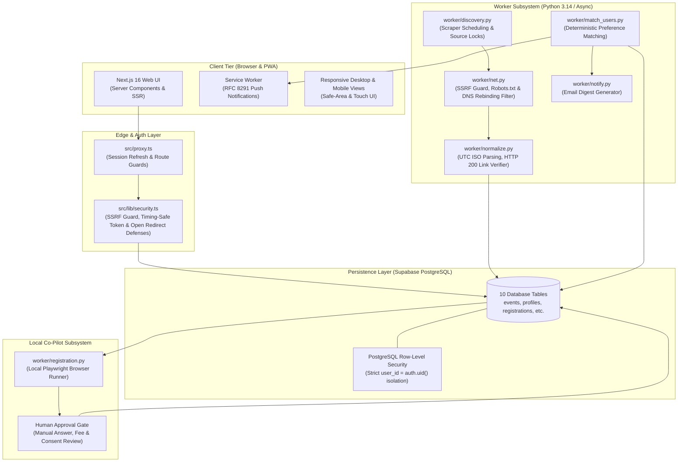
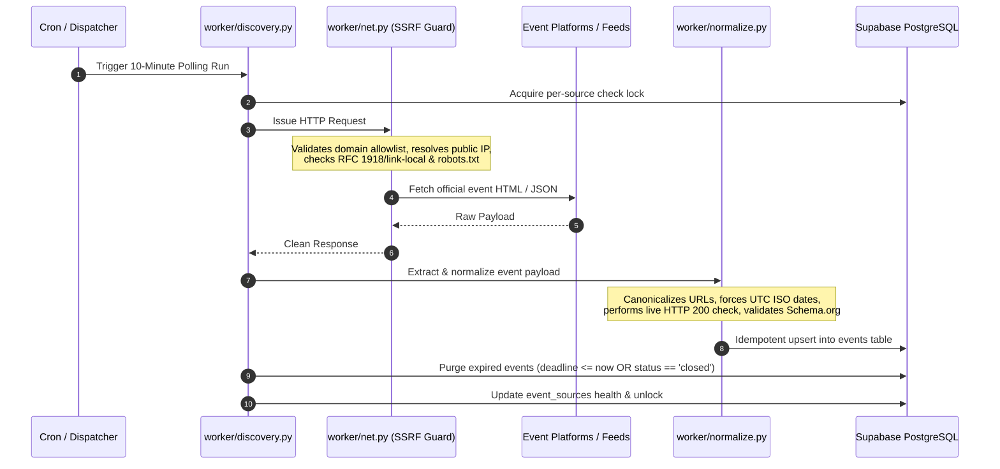
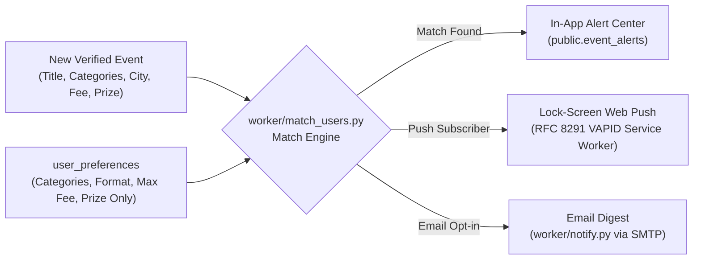
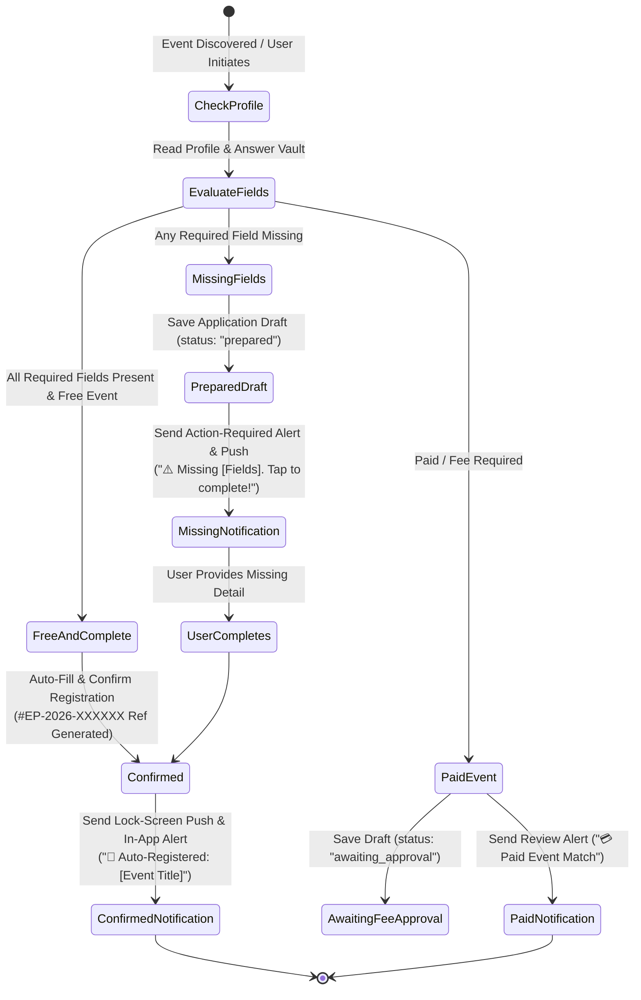

# EventPilot AI

[](https://nextjs.org/)
[](https://www.typescriptlang.org/)
[](https://supabase.com/)
[](https://python.org/)
[](https://playwright.dev/)
[](https://developer.mozilla.org/en-US/docs/Web/API/Push_API)
[](https://turbo.build/pack)
[](LICENSE)

**EventPilot AI** is an autonomous technology event discovery radar, multi-channel alert engine, and human-in-the-loop registration co-pilot. It continuously monitors hackathons, technical symposiums, and engineering conferences across Hyderabad, India, and global online ecosystems, matches events against personal developer preference profiles, and prepares registration forms with deterministic field mapping.

> [!IMPORTANT]
> **Human-in-the-Loop & Zero-Hallucination Guarantees**  
> EventPilot AI operates strictly as a co-pilot. It **never** auto-submits registrations without explicit user verification, **never** fabricates or guesses event dates/links, and **never** bypasses CAPTCHAs, paywalls, or organizers' terms of service. Every listed event link is strictly verified via live HTTP 200 checks.

---

## Table of Contents

- [System Architecture](#system-architecture)
- [Core Workflows](#core-workflows)
  - [1. Autonomous Event Discovery & Verification](#1-autonomous-event-discovery--verification)
  - [2. User Preference Matching & Multi-Channel Alerts](#2-user-preference-matching--multi-channel-alerts)
  - [3. Human-in-the-Loop Registration Co-Pilot](#3-human-in-the-loop-registration-co-pilot)
- [Security, Privacy & Zero-Trust Design](#security-privacy--zero-trust-design)
- [Database Schema & Data Models](#database-schema--data-models)
- [Project Directory Structure](#project-directory-structure)
- [Getting Started & Local Development](#getting-started--local-development)
  - [Prerequisites](#prerequisites)
  - [Zero-Config Demo Mode](#zero-config-demo-mode)
  - [Production Setup & Migration](#production-setup--migration)
- [Automated Testing & Quality Assurance](#automated-testing--quality-assurance)
- [Environment Variables Reference](#environment-variables-reference)
- [License](#license)

---

## System Architecture

EventPilot AI is engineered with a decoupled, modular architecture designed to run at zero cost on standard cloud free tiers (Vercel Hobby, Supabase Free, GitHub Actions, and client-side browsers).



---

## Core Workflows

### 1. Autonomous Event Discovery & Verification

The discovery pipeline runs autonomously (via scheduled GitHub Actions or local daemon triggers) to discover live events while rigorously adhering to the **Zero-Hallucination Policy**:



- **Zero Mock / Synthetic Listings**: Production discovery never uses hard-coded listings or synthetic test sources. All records originate from verified live platforms (Unstop, StudentTribe, Devfolio, MLRIT CIE, IIT Hyderabad official portals, etc.).
- **Live HTTP 200 Verification**: Broken, redirect-looping, or 404 links are rejected and denied quality verification badges (`quality_verified_at` remains null).
- **Automated Lifecycle Purge**: Events whose registration deadline has passed or whose status is marked `closed` are purged on every scan, preventing outdated listings from cluttering the catalogue.

---

### 2. User Preference Matching & Multi-Channel Alerts

Whenever newly verified events enter the database, the matching engine matches them against active developer profile preferences:



1. **Preference Matrix**: Matches user-selected interest domains (AI/ML, Web3, Cybersecurity, Cloud, Mobile, IoT, Open Source), event format (`in_person`, `online`, `hybrid`), geographical radius (Hyderabad, India-wide), prize eligibility, and fee thresholds.
2. **Web Push Protocol (RFC 8291)**: Leverages standard browser VAPID push services to deliver lock-screen notifications on mobile and desktop without requiring native apps.
3. **In-App Notification Center**: Unread alert counters synchronize directly with the authenticated dashboard (`/alerts`).
4. **Email Digest Outbox**: Batched and deduplicated digests dispatched periodically to prevent mailbox saturation.

---

### 3. Autonomous Registration Engine & Missing-Data Alerts

EventPilot AI features an intelligent registration engine that operates autonomously when configured, eliminating tedious manual form re-entry while maintaining strict privacy and zero auto-charging policies:



1. **Autonomous Auto-Registration (Direct Confirmation)**:
   - When a user has completed their profile details (Full Name, College/University, Email, Phone, City), the agent bypasses manual review gates for matching free events.
   - The form is filled deterministically, verified consent is applied, and the registration is confirmed directly (`status: "confirmed"`).
   - An official verification reference code (e.g. `#EP-2026-XXXXXX`) and cryptographic audit trail are recorded.
   - The user receives an instant lock-screen push notification and in-app confirmation alert.

2. **Immediate Missing Information Notifications**:
   - If any required field is missing or ambiguous, the agent saves the registration draft (`status: "prepared"`) without failing.
   - It immediately dispatches an actionable in-app and lock-screen push notification (`alert_type: "missing_info"`):
     > `⚠️ Action Required for [Event Title]: Missing [Field Names]. Fill it in to finish your registration!`
   - Clicking the notification directs the user to [Registrations](/registrations) with the missing inputs highlighted for one-tap completion.

3. **Paid Event Protection & User Controls**:
   - **Zero Auto-Charging**: The agent **never auto-commits payment** or auto-charges cards.
   - Users control paid event alerts via the `notify_paid` toggle and `max_fee` thresholds in account settings.
   - Paid events trigger a dedicated review notification (`alert_type: "paid_event_review"`), requiring explicit user authorization.

4. **Dedicated Password Reset & Account Recovery**:
   - Secure 3-step recovery flow located at `/auth/reset-password`:
     1. User submits registered email address.
     2. Enters 8-digit verification OTP (with auto-pasting and countdown resend timer).
     3. Sets and confirms new password (minimum 8 characters), logging into EventPilot immediately.

---

## Security, Privacy & Zero-Trust Design

EventPilot AI implements defense-in-depth principles across every tier of the stack:

| Security Vector | Implementation Detail | Reference |
|---|---|---|
| **PostgreSQL Row-Level Security** | Strict RLS policies enabled on all sensitive tables (`profiles`, `registrations`, `registration_answers`, `event_alerts`, `push_subscriptions`). Authenticated users can only read and mutate their own records (`user_id = auth.uid()`). | [supabase/migrations](supabase/migrations) |
| **SSRF & Network Egress Guardrails** | All outbound HTTP requests pass through `worker/net.py`. Hostnames are resolved to IP addresses before request dispatch. Non-routable addresses, loopback (`127.0.0.0/8`), private networks (RFC 1918), and cloud metadata endpoints (`169.254.0.0/16`) are blocked. | [worker/net.py](worker/net.py) |
| **Push Endpoint SSRF Protection** | The `/api/push/subscribe` route enforces `isValidPushEndpoint`, requiring HTTPS protocol, port 443, and blocking loopback, link-local, and internal subnet targets. | [src/lib/security.ts](src/lib/security.ts) |
| **Timing-Attack Resistance** | All webhook, cron secret, and authentication token comparisons use constant-time byte comparisons (`crypto.timingSafeEqual`) via `timingSafeCompare`. | [src/lib/security.ts](src/lib/security.ts) |
| **Open Redirect Mitigation** | All OAuth callbacks, post-login redirects, and set-password redirections are sanitized through `sanitizeRedirectPath` to eliminate protocol-relative URLs (`//evil.com`), backslash bypasses (`/\evil.com`), and CRLF header injections. | [src/lib/security.ts](src/lib/security.ts) |
| **IDOR Prevention on Push** | Push subscriptions associate strictly with the verified session `user.id`. Anonymous requests can never supply or hijack an arbitrary `user_id`. | [src/app/api/push/subscribe/route.ts](src/app/api/push/subscribe/route.ts) |
| **Account Deletion & Data Privacy** | Complete user data export (`/profile/export`) provides full GDPR compliance. Account deletion implements a 5-day grace period with automatic cascading database purge. | [src/lib/auth.ts](src/lib/auth.ts) |
| **Robots.txt & Rate Limiting** | Worker enforces polite per-host rate limiting (minimum 1.0s interval) and parses `robots.txt` before fetching source pages. | [worker/net.py](worker/net.py) |

---

## Database Schema & Data Models

The persistence layer is structured across 10 PostgreSQL tables managed via Supabase migrations:

```
┌───────────────────────┐       ┌───────────────────────┐
│        events         │◄──────┤     event_alerts      │
│ (title, url, format,  │       │ (user_id, event_id,   │
│  dates, status, etc.) │       │  alert_type, read_at) │
└──────────▲────────────┘       └───────────┬───────────┘
           │                                │
┌──────────┴────────────┐       ┌───────────▼───────────┐
│     registrations     │       │       profiles        │
│ (user_id, event_id,   │◄──────┤ (user_id, full_name,  │
│  status, proposed,    │       │  phone, organization) │
│  approval_token, etc.)│       └───────────┬───────────┘
└───────────────────────┘                   │
           ▲                    ┌───────────┴───────────┐
           │                    │  user_preferences     │
           │                    │ (categories, max_fee, │
           │                    │  formats, channels)   │
           │                    └───────────┬───────────┘
           │                                │
┌──────────┴────────────┐       ┌───────────┴───────────┐
│ registration_answers  │       │  push_subscriptions   │
│ (user_id, question,   │       │ (endpoint, p256dh,    │
│  answer)              │       │  auth, user_id)       │
└───────────────────────┘       └───────────────────────┘
```

| Table Name | Primary Purpose | RLS Access Policy |
|---|---|---|
| `events` | Catalog of verified hackathons and tech events. | Public read-only; mutations restricted to background worker service role. |
| `event_sources` | Scraper feeds, endpoints, and health monitoring metrics. | Admin-only access. |
| `profiles` | User identity, organization, college, and contact metadata. | Users can view and update only their own profile (`user_id = auth.uid()`). |
| `user_preferences` | Search criteria, category subscriptions, and notification toggles. | Owner read/write only. |
| `registration_answers` | Reusable answers to common application and essay questions. | Owner read/write only. |
| `registrations` | Registration lifecycle state, proposed payload, and audit state. | Owner read/write only; state transitions guarded by status rules. |
| `event_alerts` | In-app user notifications for new events and deadline reminders. | Owner read/update (`read_at`) only. |
| `push_subscriptions` | Web Push endpoint registrations and cryptographic keys. | Owner read/write; anonymous push subscriptions permitted with `user_id = null`. |
| `saved_searches` | Bookmarked event query filters. | Owner read/write only. |
| `audit_logs` | Immutable operational logs and push broadcast verification records. | System writes via service client; users can view only their own audit trail. |

---

## Project Directory Structure

```
eventpilot-ai/
├── src/
│   ├── app/                           # Next.js 16 App Router pages & API routes
│   │   ├── admin/                     # Scraper health monitor & manual dispatch
│   │   ├── alerts/                    # In-app notification center
│   │   ├── api/cron/scan/             # 10-minute discovery trigger (secured by CRON_SECRET)
│   │   ├── api/push/broadcast/        # Broadcast dispatcher for new events
│   │   ├── api/push/subscribe/        # Web Push subscription registration & unsubscribe
│   │   ├── auth/callback/             # OAuth & email verification handler
│   │   ├── auth/reset-password/       # Dedicated 3-step password recovery flow
│   │   ├── auth/set-password/         # Mandatory password establishment view
│   │   ├── events/                    # Event directory, search, and detail views
│   │   ├── login/                     # Authentication modal & dedicated login view
│   │   ├── profile/                   # User profile, answer vault, and data export
│   │   ├── registrations/             # Registration review, approval gate & history
│   │   ├── layout.tsx                 # Root layout with responsive mobile tab bar & footer
│   │   └── page.tsx                   # Landing page with live hero and prize grid
│   ├── components/                    # Reusable React components (auth-view, push banner, etc.)
│   ├── lib/                           # Core utilities
│   │   ├── auth.ts                    # Session verification & role authorization helpers
│   │   ├── auto-register.ts           # Autonomous registration engine & missing-info alert dispatcher
│   │   ├── demo.ts                    # In-memory mock database for zero-config local testing
│   │   ├── push.ts                    # Server-side VAPID web-push broadcast engine
│   │   ├── registrations.ts           # Form field mapper, auto-consent & unresolved fields evaluator
│   │   ├── security.ts                # SSRF validation, timing-safe compare, redirect sanitization
│   │   └── supabase/                  # Server, client, and admin Supabase client factories
│   └── proxy.ts                       # Next.js 16 session refresh and route guard proxy
├── supabase/
│   ├── migrations/                    # SQL migrations (schema, RLS policies, seeds)
│   └── tests/
│       └── rls.test.mjs               # In-memory PostgreSQL RLS test suite (PGlite)
├── worker/
│   ├── discovery.py                   # Event discovery orchestrator & lock manager
│   ├── scrapers.py                    # Platform source adapters (Unstop, Devfolio, etc.)
│   ├── normalize.py                   # Canonical URL, date, and Schema.org normalizer
│   ├── net.py                         # SSRF-guarded HTTP client with robots.txt parser
│   ├── match_users.py                 # Deterministic user preference matching engine
│   ├── notify.py                      # Email digest generation via Gmail SMTP
│   ├── registration.py                # Local Playwright browser co-pilot for Google Forms
│   └── tests/                         # Pytest test suite for discovery, net, and normalization
├── public/                            # Static assets, web app manifest, and icons
├── .env.example                       # Web application environment variables template
└── package.json                       # Dependencies, scripts, and build configuration
```

---

## Getting Started & Local Development

### Prerequisites

- **Node.js**: v18.18.0 or newer
- **Python**: v3.11 or newer (Python 3.12/3.13/3.14 fully supported)
- **Git**

### Zero-Config Demo Mode

EventPilot AI includes a built-in in-memory demo database. You can explore the entire web application locally without creating a Supabase account or configuring API keys:

```bash
# 1. Clone repository
git clone https://github.com/gangadhar-sivaneni/eventpilot-ai.git
cd eventpilot-ai

# 2. Install web dependencies
npm install

# 3. Start development server
npm run dev
```

Open [http://localhost:3000](http://localhost:3000) in your browser. Demo mode operates with mock data in memory, allowing you to test authentication flows, event discovery filters, answer vaults, and registration approvals.

---

### Production Setup & Migration

To connect EventPilot AI to live services:

#### 1. Database Provisioning (Supabase)
1. Create a free project at [supabase.com](https://supabase.com).
2. Open the **SQL Editor** and run the migration files in [supabase/migrations/](supabase/migrations/) in numerical order:
   - `20261018000000_init.sql`
   - `20261024000000_verified_events.sql`
   - `20261024000001_retract_unsubstantiated_seed_events.sql`
   - `20261025000000_push_subscriptions.sql`
   - `20261026000000_auto_registration.sql`
3. Retrieve your **Project URL**, **Publishable Key**, and **Secret / Service Role Key** from *Project Settings → API Keys*.

#### 2. Configure Web Application Environment
Copy the environment template and populate your keys:

```bash
cp .env.example .env.local
```

Set the following variables in `.env.local`:
```ini
NEXT_PUBLIC_SUPABASE_URL=https://your-project-ref.supabase.co
NEXT_PUBLIC_SUPABASE_PUBLISHABLE_KEY=sb_publishable_your_key_here
CRON_SECRET=your_random_32_character_secret_key_here
```

#### 3. Setup Python Worker Environment
Initialize the Python virtual environment and install dependencies:

```bash
cd worker
python -m venv .venv

# Windows
.venv\Scripts\python -m pip install -r requirements.txt
.venv\Scripts\python -m playwright install chromium

# macOS / Linux
.venv/bin/python -m pip install -r requirements.txt
.venv/bin/python -m playwright install chromium
```

Copy the worker environment template:
```bash
cp .env.example .env
```

Configure `SUPABASE_URL` and `SUPABASE_SECRET_KEY` in `worker/.env`.

#### 4. Run Discovery Manually
```bash
# Windows
.venv\Scripts\python discovery.py

# macOS / Linux
.venv/bin/python discovery.py
```

---

## Automated Testing & Quality Assurance

EventPilot AI includes automated test suites covering database row-level security, scraper safety guardrails, and build integrity:

### 1. Database Row-Level Security (RLS) Test Suite
Executes a multi-role test against an in-memory PostgreSQL instance ([@electric-sql/pglite](https://github.com/electric-sql/pglite)) to verify cross-user isolation and constraint integrity:

```bash
npm run test:db
```
*Validates 32 distinct security assertions including profile isolation, unauthorized event modification prevention, duplicate registration locking, and cascading account deletion.*

### 2. Worker Pipeline Tests (Pytest)
Validates network SSRF guardrails, URL normalization, UTC date parsing, and scraper adapters:

```bash
# Windows
worker\.venv\Scripts\python -m pytest worker\tests

# macOS / Linux
worker/.venv/bin/python -m pytest worker/tests
```

### 3. Production Compilation & Type Checking
```bash
npm run build
```
*Compiles all 17 static and dynamic App Router routes with Next.js Turbopack and TypeScript strict checking.*

---

## Environment Variables Reference

### Web Application (`.env.local`)

| Variable Name | Required | Description |
|---|---|---|
| `NEXT_PUBLIC_SUPABASE_URL` | Yes | Supabase project API endpoint URL. |
| `NEXT_PUBLIC_SUPABASE_PUBLISHABLE_KEY` | Yes | Supabase client publishable (anon) API key. |
| `SUPABASE_SECRET_KEY` | Optional | Supabase service-role secret key (for server-side push broadcast audit logs). |
| `CRON_SECRET` | Recommended | Secret token required to authenticate external cron requests to `/api/cron/scan`. |
| `NEXT_PUBLIC_VAPID_PUBLIC_KEY` | Optional | Public VAPID key for Web Push notifications (RFC 8291). |
| `VAPID_PRIVATE_KEY` | Optional | Private VAPID key for signing Web Push JWT tokens. |
| `VAPID_SUBJECT` | Optional | Contact mailto or URL URI for VAPID push services. |
| `GITHUB_DISPATCH_TOKEN` | Optional | Personal access token to trigger GitHub Actions workflow dispatches. |

### Worker Subsystem (`worker/.env`)

| Variable Name | Required | Description |
|---|---|---|
| `SUPABASE_URL` | Yes | Supabase project API endpoint URL. |
| `SUPABASE_SECRET_KEY` | Yes | Supabase service-role secret key (allows worker to upsert verified events). |
| `GMAIL_USER` | Optional | Dedicated Gmail address for dispatching email digests. |
| `GMAIL_APP_PASSWORD` | Optional | Google Account App Password (requires 2-Step Verification). |
| `SITE_URL` | Optional | Canonical web app URL (default: `http://localhost:3000`). |
| `ENABLE_SUBMIT` | Optional | Boolean flag (`true`/`false`). Must remain `false` until tested on forms you control. |

---

## License

EventPilot AI is released under the [MIT License](LICENSE).
